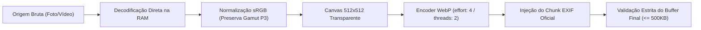

# ⚡ WhatsApp Auto Sticker

<p align="center">
  
  
  
  
  
  
</p>

<p align="center">
  <strong>Transforme qualquer foto, vídeo ou GIF recebido no WhatsApp em figurinhas profissionais instantâneas (estáticas e animadas), com menu interativo por enquete, efeitos visuais, compressão adaptativa inteligente e metadados oficiais do WhatsApp.</strong>
</p>

---

## 🎯 O que é o Projeto?

O **WhatsApp Auto Sticker** é uma aplicação completa em **Node.js** e **TypeScript** que conecta à **sua própria conta de WhatsApp** (via WebSocket Baileys Multi-Device). 

Ele atua silenciosamente em conversas privadas (1x1): assim que uma foto, vídeo ou GIF é recebido, o bot pode convertê-lo instantaneamente ou enviar um **menu interativo por enquete** para que você ou seus amigos escolham o estilo da figurinha antes de gerar.

```
Amigo no WhatsApp ───(Envia Foto/Vídeo)───► Seu WhatsApp (Bot Conectado)
                                                   │
                        ┌──────────────────────────┴──────────────────────────┐
                        ▼                                                     ▼
              [Modo Interativo 🗳️]                                    [Modo Automático ⚡]
     Envia Enquete Oficial no Chat:                                Converte imediatamente
     - 📸 Imagem estática                                          e devolve a figurinha
     - 🎞️ Figurinha animada                                        em menos de 2 segundos!
     - 🎭 Meme (Com texto)
     - ✨ Contorno Branco Suave
     - 🌑 Sombra Projetada
```

---

## ✨ Recursos Principais

- 🖼️ **Transcodificação Direta para WebP:** Converte direto para WebP 512×512 sem passar por formatos intermediários em JPEG, evitando perda de qualidade (*generation loss*) e artefatos.
- 🎨 **Fidelidade de Cores (sRGB):** Normaliza fotos tiradas em iPhones e câmeras modernas (Display P3) para o espaço de cores sRGB padrão, garantindo cores vivas e sem perfil ICC pesado.
- 🎞️ **Figurinhas Animadas Otimizadas:** FFmpeg adaptativo (8 a 12 FPS) com `-loop 0`, fundo transparente real (`format=rgba`), duração calibrada até 10s e peso rigorosamente controlado para respeitar o limite de 500 KB do WhatsApp.
- 🗳️ **Menu Interativo por Enquetes Nativas:** Permite selecionar o efeito desejado tocando nas opções da enquete do próprio WhatsApp.
- 🎭 **Criador de Memes e Efeitos Visuais:** Adiciona textos no estilo Meme Moderno (card com textos limpos no topo e rodapé), contorno de destaque fino (`/outline`) e sombras projetadas (`/shadow`).
- 💎 **Sistema VIP e Limites Diários:** Controle de cotas por usuário, ranking dos mais ativos e ativação de VIP automática por envio de comprovante PIX.
- 📱 **Multiplataforma Real (Desktop, Servidor e Android Termux):** Motor híbrido com Sharp para alto rendimento em computadores/VPS e fallback 100% nativo em FFmpeg para rodar no celular via Termux sem erros de compilação.
- 🛡️ **Segurança e Privacidade Total:**
  - **Invisível em Grupos:** Mensagens em grupos são descartadas na raiz (não consome CPU nem responde).
  - **Prevenção de Loops:** Não processa mensagens enviadas pelo próprio número.
  - **Controle de Concorrência:** Fila com limite de jobs e subprocessos limitados a 2 threads para proteger a CPU.

---

## ⚡ Guia Rápido de Instalação (3 Passos)

```bash
# 1. Clone o repositório e instale as dependências
git clone https://github.com/ThiagoIbrahimVieira/whatsappbot.git whatsapp-auto-sticker
cd whatsapp-auto-sticker
npm install

# 2. Crie seu arquivo de configuração
cp .env.example .env

# 3. Compile e inicie o bot
npm run build
npm start
```

*Um QR Code aparecerá no terminal. Abra o WhatsApp no celular > **Aparelhos Conectados** > **Conectar um aparelho** e aponte para a tela.*

---

## 📚 Documentação Detalhada por Seções

Para manter o projeto organizado e fácil de consultar, separamos a documentação técnica em manuais dedicados:

| Documento | Conteúdo |
| :--- | :--- |
| 🏛️ [**Guia de Arquitetura e Engenharia**](docs/arquitetura.md) | Fluxo detalhado de camadas, pipeline de transcodificação, injeção de EXIF, controle de CPU e regras de concorrência. |
| 🚀 [**Guia de Instalação Completo**](docs/instalacao.md) | Passo a passo para Windows, Linux (VPS com PM2) e resolução de dependências. |
| 📱 [**Guia de Execução no Android (Termux)**](docs/termux.md) | Como rodar o bot 24/7 direto no smartphone sem computador e sem root. |
| 🎮 [**Manual de Comandos e Enquetes**](docs/comandos.md) | Lista de todos os comandos de usuário, efeitos (`/outline`, `/meme`), comandos VIP e controles de administração. |
| ⚙️ [**Referência de Configurações (.env)**](docs/configuracao.md) | Explicação de cada variável de ambiente, limites de tamanho, portas do web server e chaves PIX. |

---

## 🔬 Otimizações de Performance Aplicadas

Em auditoria técnica recente no pipeline de mídia, o projeto adotou quatro princípios fundamentais:



1. **Zero Reencodificação JPEG:** A mídia de entrada nunca passa por JPEG intermediário. O redimensionamento e a compressão são feitos em memória direto para WebP.
2. **Validação do Buffer Final com EXIF:** O limite de tamanho é medido **após** a inserção dos metadados de pacote, eliminando rejeições do WhatsApp por arquivos que estouram os 500 KB após a injeção do EXIF.
3. **Limite de Threads e Concorrência:** O Sharp e o FFmpeg foram limitados a 2 threads cada (`-threads 2`), impedindo travamentos de CPU quando múltiplos usuários enviam mídias simultâneas.
4. **Espaço de Cores sRGB:** Converte o perfil de cor antes de descartar metadados ICC pesados, mantendo cores vibrantes em fotos de iPhones.

---

## 🧪 Testes Automatizados

O projeto conta com uma suíte de **132 testes unitários e de integração** implementados com **Vitest**, garantindo confiabilidade total em cada alteração:

```bash
npm test
```

---

## ⚖️ Aviso Legal

Este projeto é uma ferramenta de uso estritamente pessoal e educacional, utilizando a biblioteca não oficial Baileys para conexão ao WhatsApp Web. Não é afiliado, patrocinado ou endossado pela Meta Platforms, Inc. ou WhatsApp Inc. Utilize com responsabilidade em conformidade com as diretrizes do serviço.

---

<p align="center">
  Desenvolvido por <strong>Thiago Ibrahim</strong> 🚀
</p>
