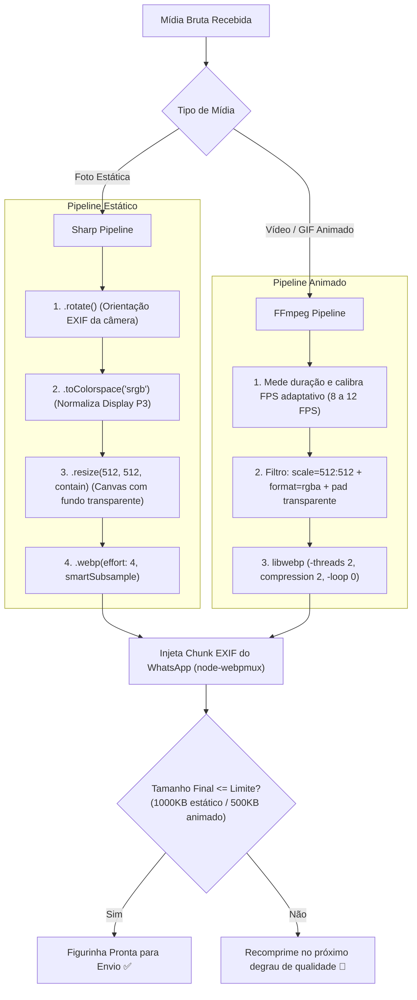

# 🏛️ Arquitetura do Sistema — WhatsApp Auto Sticker

Este documento descreve detalhadamente o design técnico, a estrutura de camadas, os pipelines de mídia e os mecanismos de segurança e concorrência do bot.

---

## 1. Visão Geral em Camadas

O projeto foi construído sobre princípios de responsabilidade única e desacoplamento, separando a camada de conexão com o WhatsApp dos motores de processamento binário:

```
┌─────────────────────────────────────────────────────────────┐
│                    WhatsApp Network                         │
└──────────────────────────────┬──────────────────────────────┘
                               │ WebSocket (Baileys Multi-Device)
                               ▼
┌─────────────────────────────────────────────────────────────┐
│ Camada de Comunicação (src/whatsapp/)                       │
│  ├── Connection & Auth (Chaves de sessão criptografadas)    │
│  ├── MessageRouter (Filtros: grupos, próprios, tipos)       │
│  ├── InteractiveMessages (Enquetes nativas interativas)     │
│  └── MediaDownloader / StickerSender                        │
└──────────────────────────────┬──────────────────────────────┘
                               │ Mídia Descriptografada
                               ▼
┌─────────────────────────────────────────────────────────────┐
│ Camada de Fila e Concorrência (src/queue/)                  │
│  └── JobQueue (Concorrência máx = 2, proteção de CPU/RAM)   │
└──────────────────────────────┬──────────────────────────────┘
                               │ Disparo do Worker
                               ▼
┌─────────────────────────────────────────────────────────────┐
│ Camada de Processamento de Mídia (src/media/)               │
│  ├── ImageProcessor (Sharp libvips com sRGB e effort 4)     │
│  ├── VideoProcessor (FFmpeg adaptativo com -threads 2)      │
│  ├── GifProcessor (Roteamento estático vs animado)          │
│  ├── MemeProcessor & EffectsProcessor (Textos e estilos)    │
│  └── Metadata (Injeção de chunk EXIF oficial do WhatsApp)   │
└─────────────────────────────────────────────────────────────┘
```

---

## 2. Pipeline de Transcodificação de Mídia

O processamento foi arquitetado para evitar gargalos e perdas de qualidade desnecessárias:



### 2.1 Conversão Direta para WebP (Zero desvio em JPEG)
- Não há conversão intermediária para JPEG ou PNG antes da figurinha final. A imagem de entrada é decodificada diretamente na memória da biblioteca `libvips` (Sharp) ou nos buffers de quadros do FFmpeg e gravada diretamente no container `.webp`.
- **Por que isso importa?** O JPEG descarta o canal alfa (transparência) e introduz artefatos de compressão de blocos 8x8. Converter de JPEG para WebP gera compressão dupla (generation loss) e estoura o limite de tamanho final.

### 2.2 Espaço de Cores e Descarte de Metadados
- Câmeras modernas de smartphones (especialmente iPhones) gravam fotos no gamut amplo **Display P3**.
- Se um bot apenas remove o perfil ICC sem converter as coordenadas de cor, a figurinha fica desbotada ou lavada. O nosso pipeline executa `.toColorspace('srgb')` antes de salvar o WebP, garantindo cores vibrantes e compatibilidade absoluta com a tela de qualquer aparelho.
- Metadados sensíveis (geolocalização GPS, modelo da câmera, miniaturas) são descartados automaticamente, poupando dezenas de kilobytes.

### 2.3 Especificação EXIF do WhatsApp
- O WhatsApp exige um chunk EXIF formatado no contêiner RIFF/WebP contendo metadados de pacote (`sticker-pack-name`, `sticker-pack-publisher`) e tag `0x08` no cabeçalho VP8X.
- O arquivo [src/media/metadata.ts](file:///src/media/metadata.ts) utiliza `node-webpmux` para adicionar esse cabeçalho estritamente com os campos oficiais (~200 bytes), permitindo que a figurinha seja favoritada e compartilhada mantendo os créditos.

---

## 3. Concorrência e Gestão de Recursos

O bot opera com controle de recursos em dois níveis para garantir que nunca trave o servidor ou celular:

1. **Nível de Fila (`JobQueue`):**
   - Limita a concorrência global a `MAX_CONCURRENT_JOBS` (padrão = 2).
   - Se 10 usuários enviarem mídias simultâneas, apenas 2 serão transcodificadas concorrentemente. As 8 restantes aguardam na fila e são processadas conforme os slots são liberados.
   - Cada job possui timeout de segurança de 60 segundos contra travamentos.

2. **Nível de Processos e Threads:**
   - **Sharp:** Configurado explicitamente com `sharp.concurrency(2)` para restringir o threadpool nativo do libvips, evitando que um único resize monopolize 100% da CPU.
   - **FFmpeg:** Invocado com `-threads 2` e `-nostdin`. Isso impede que processos filhos criem dezenas de threads e causem *CPU thrashing* (engasgando o loop de eventos do Node e a conexão do WhatsApp).

---

## 4. Regras de Isolamento e Segurança

- **Regra Absoluta de Grupos:** O `MessageRouter` verifica imediatamente o JID da mensagem. Qualquer mensagem originada de `@g.us` é descartada na raiz, sem baixar mídias, sem tocar no disco e sem enviar qualquer resposta.
- **Prevenção de Loops:** Mensagens marcadas como `key.fromMe = true` são descartadas quando `IGNORE_OWN_MESSAGES=true`.
- **Deduplicação de Mensagens:** Um cache LRU com TTL registra os IDs das mensagens já processadas para evitar reprocessamento em caso de reconexão do Baileys.
- **Sanitização de Caminhos:** O executável FFmpeg é chamado diretamente via `execFile` com argumentos em array (sem passar por shell do SO), eliminando qualquer vulnerabilidade de injeção de comandos.
- **Limpeza Automática:** Cada job cria um diretório temporário isolado em `temp/<jobId>` que é completamente excluído após o envio da figurinha.
